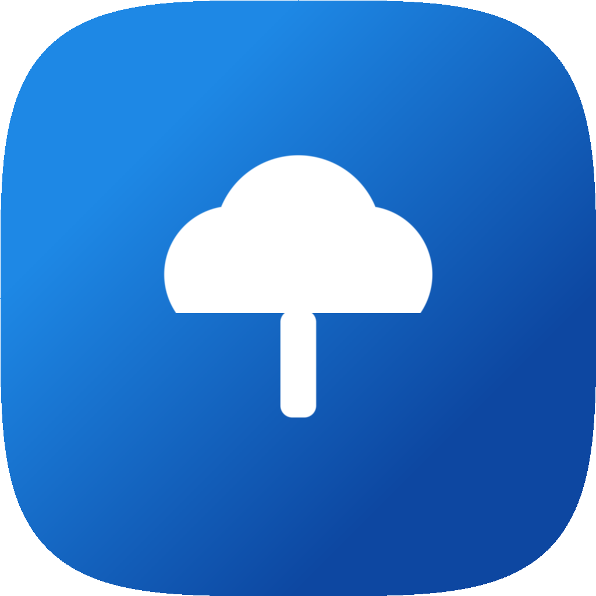

<p align="center">
  
</p>

<h1 align="center">Canopy</h1>

<p align="center">
  A powerful macOS menu bar utility packed with productivity and developer tools.
</p>

<p align="center">
  <a href="https://github.com/keshavgarg24/canopy/releases">Download</a> ·
  <a href="https://github.com/keshavgarg24/canopy/issues">Report a Bug</a> ·
  <a href="https://x.com/canopy_mac">Follow on X</a>
</p>

---

## Features

Canopy lives in your menu bar and gives you instant access to 40+ tools across categories:

**Productivity**
- Clipboard History, Text Snippets, Focus Session, Time Tracker
- World Clock, Quick Launcher, Keep Awake, Notification History
- App Timer, Unit Converter, Command Bar

**Developer Tools**
- JSON Formatter, QR Code Generator, Hash Generator
- Port Manager, Environment Manager, WiFi Scanner
- Developer Cleaner, Storage Analyzer

**System**
- CPU & Memory Monitor, System Health, Battery Time
- Brightness Control, Volume Control, Display Management
- Screenshot Tools, Screen Mirror

**Media & Notch**
- Now Playing with lyrics, equalizer, queue
- Dynamic Island / Notch integration for music, files, clipboard
- Audio mixer, microphone control

## Requirements

- macOS 14.0 (Sonoma) or later
- Apple Silicon or Intel Mac

## Build

```bash
# Developer build (installs to /Applications)
./build.sh --install

# Run tests
./build.sh --test
```

## License

GPL-3.0 — see [LICENSE](LICENSE).
